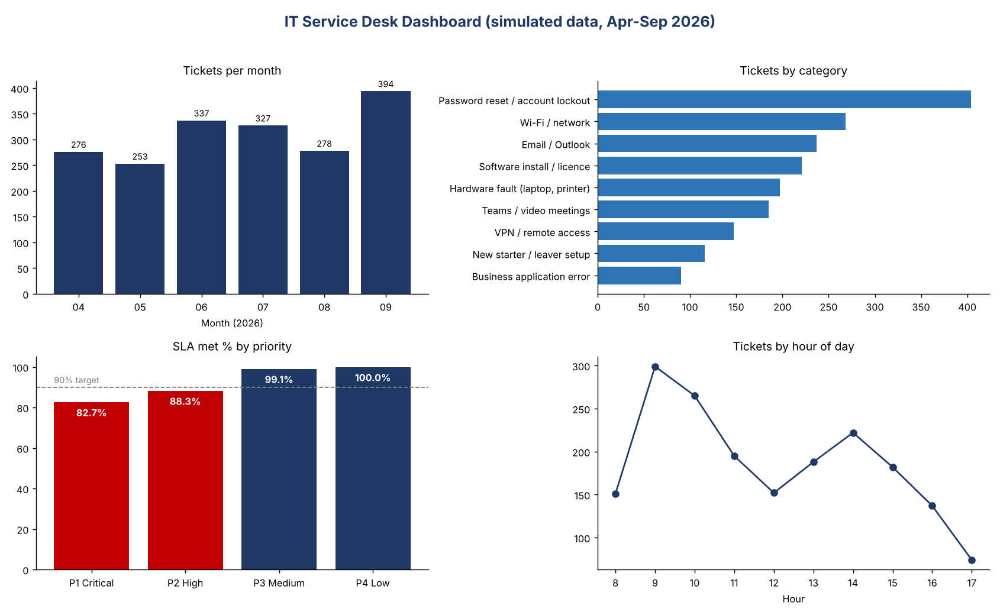
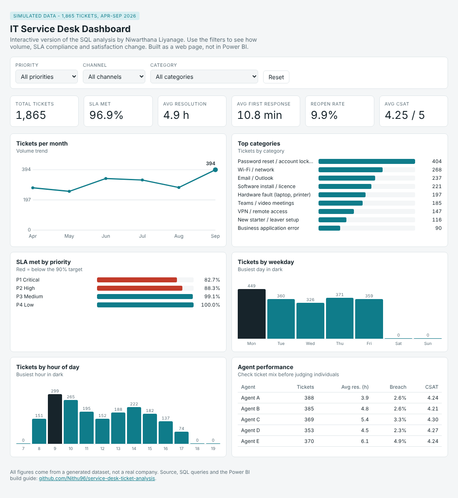

# IT Service Desk Ticket Analysis (SQL + Python + Dashboard)

A small portfolio project that analyses IT service desk tickets to answer the questions a service desk
manager asks every week: *What are people contacting us about? Are we meeting our SLAs? When are we busiest?
Where can we reduce volume?*

> **Important: the data is simulated.** No real company, employee or customer data is used. I generated
> 1,865 tickets for Apr-Sep 2026 with `scripts/generate_data.py` (fixed random seed, so results are reproducible).
> The findings below describe this simulated dataset and are for demonstration only.

## Tools
SQL (SQLite syntax, includes aggregates, CASE, a subquery and a window function), Python (data generation,
charts), an interactive HTML dashboard (`dashboard/`), and a Power BI build guide (`powerbi/`) for anyone with Power BI Desktop. The dashboard in this repo was not built in Power BI.

## Dataset (`data/tickets_simulated.csv`)
| Column | Meaning |
|---|---|
| ticket_id, created_at | Ticket reference and creation time |
| category, priority, channel, agent | How the ticket was raised and handled |
| first_response_mins, resolution_hours | Response and resolution times |
| sla_target_hours, sla_breached | SLA target for the priority (P1 4h, P2 8h, P3 24h, P4 48h) and whether it was missed |
| reopened, csat_score | Whether the ticket was reopened, and customer satisfaction (1-5) |

## Dashboard


## Interactive dashboard


A web version of the dashboard (filters for priority, channel and category) is in `dashboard/service-desk-dashboard.html`. Download it and open it in any browser. It is built as an HTML page, not in Power BI.

## Key findings (simulated data)
1. **Password and account lockouts are the biggest driver: 21.7% of all tickets**, but resolve in under an hour
   on average. A self-service password reset tool would remove a fifth of the queue.
2. **P1 (Critical) and P2 (High) tickets miss their SLA most often:** 82.7% and 88.3% met, below a 90% target.
   P3 and P4 are at 99% or better, so the issue is urgent tickets, not overall capacity.
3. **Business application errors are the weakest category:** 20% breach SLA and 18.9% are reopened, with the longest
   average resolution (13.6 hours). Worth a root cause review with the application owners.
4. **Demand is predictable.** Monday is the busiest day (449 tickets vs about 350 on other days) and 9-10am is the
   peak hour, so cover should be weighted there. September volume was 43% higher than April.
5. **A missed SLA or a reopened ticket hurts satisfaction:** average CSAT is 4.32 for clean tickets, 3.84 if
   reopened and 3.49 if the SLA was missed.
6. In this dataset one agent (Agent E) has the slowest average resolution (6.1 hours vs 3.9 for the fastest) and the
   highest breach rate (4.9%). In real life I would check ticket mix before drawing conclusions about individuals.

## Recommendations
- Introduce self-service password reset; track the monthly share of password tickets (query Q10).
- Review the escalation path for P1/P2 tickets and add Monday morning cover.
- Run a problem-management review on recurring business application errors.
- Add a "reopened" check before closing tickets, to protect satisfaction scores.

## How to run
```
pip install matplotlib
python scripts/generate_data.py      # creates data/tickets_simulated.csv
python scripts/run_analysis.py       # runs sql/queries.sql, saves results/*.csv and charts/dashboard.png
```
The ten queries are in `sql/queries.sql`, and each one's output is saved in `results/`.

## Author
Niwarthana Liyanage - [LinkedIn](https://www.linkedin.com/in/niwarthana)
